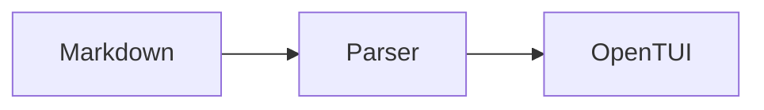

# TalkTUI Docs

## Run

```bash
bun run deck <file.md>
bun run deck <file.md> --theme <name>
```

## Slide Structure

Slides start at Markdown headings:

```md
# Slide Title

Slide body
```

Per-slide frontmatter goes directly after the heading:

```md
# Slide Title
---
layout: two-cols
subtitle: Optional subtitle
hideFooter: true
---
```

## Layouts

- `default`
- `center`
- `cover`
- `section`
- `statement`
- `quote`
- `fact`
- `two-cols`
- `code`

## Fragments

Progressive slide clones:

```md
First

<!-- stop -->

Second
```

Reveal one block at a time:

```md
- first
- second <!-- fragment -->
- third <!-- fragment -->
```

## Slots

Two-column slides:

```md
left content

::right::

right content
```

Custom chrome:

```md
::header::
Workshop mode

::default::
Main slide content

::footer::
repo: talktui
```

## Code

````md
```ts [src/parser.ts] {2,5-8} lines title="Parser"
const deck = parse(markdown)
```
````

Supported metadata:

- `[filename]`
- `title="..."`
- `{1,3-5}` highlighted lines
- `lines` line numbers

## Callouts

```md
:::note Optional title
Useful context.
:::

:::tip
Actionable advice.
:::

:::warning
Careful.
:::

:::danger
Sharp edge.
:::
```

## Visual Primitives

```md
---
::space:3::
{width=60 height=16 fit=contain caption="caption"}
```

Images use Kitty graphics when available. Unsupported terminals fall back to a placeholder.

## Tables

```md
| Primitive | Status |
| --- | --- |
| Layouts | Done |
| Tables | Done |
```

## Mermaid

````md

````

Mermaid support currently renders simple terminal flow diagrams.

## Themes

TalkTUI includes OpenCode built-in themes plus `midnight` and `ember`.

Popular names:

- `catppuccin`
- `tokyonight`
- `gruvbox`
- `nord`
- `dracula`
- `rosepine`
- `kanagawa`
- `github`
- `monokai`
- `one-dark`

```bash
bun run deck examples/advanced.md --theme rosepine
```
