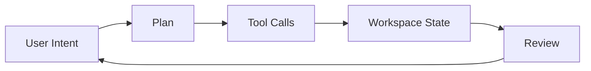

# Agentic CLIs That Don't Rot
---
layout: cover
subtitle: architecture patterns for fast, reliable coding agents
author: nexxel
date: 2026
---

The hard part is not making an agent act.

<!-- stop -->

The hard part is making its actions legible, bounded, and reversible.

# Three Constraints
---
layout: statement
subtitle: If any one fails, the product feels haunted
---

- every action must be explainable
- every state transition must be inspectable <!-- fragment -->
- every slow path must have an escape hatch <!-- fragment -->

# The Runtime Shape
---
layout: center
subtitle: a loop, not a chatbot
---



:::tip System boundary
The agent can be creative inside the loop, but the loop itself should be boring.
:::

# Deep Module Boundaries
---
layout: two-cols
subtitle: primitive interfaces beat orchestration soup
---

```ts [runtime.ts] {1-4,10-12} lines title="Runtime contract"
interface AgentRuntime {
  plan(input: UserIntent): Effect<Plan, PlanningError>
  act(plan: Plan): Effect<ChangeSet, ToolError>
  review(changeSet: ChangeSet): Effect<Review, ReviewError>
}

const program = Effect.gen(function*() {
  const plan = yield* runtime.plan(intent)
  const changes = yield* runtime.act(plan)
  return yield* runtime.review(changes)
})
```

::right::

:::warning Smell
If every function needs `context`, `state`, `logger`, `tools`, and `config`, you do not have modules. You have globals in a trench coat.
:::

# Latency Budget
---
layout: fact
title: First useful token
---

700ms

# Latency Is A Product Feature
---
layout: default
subtitle: the user forgives slow work only after fast acknowledgement
---

| Path | Budget | Product behavior |
| --- | --- | --- |
| parse intent | 50ms | no spinner |
| build plan | 300ms | stream outline |
| first tool | 700ms | show concrete action |
| full verification | async | keep UI interruptible |

# Tool Calls Are Transactions
---
layout: section
subtitle: write-ahead intent beats best-effort recovery
---

Persist the why before executing the what.

::space:2::

:::note Durable audit trail
The log should answer: what was attempted, which files changed, which checks ran, and what remains uncertain.
:::

# Bounded Autonomy
---
layout: code
subtitle: typed errors make policy visible
---

```ts [policy.ts] {2-5,13-17} lines title="Autonomy gate"
type AgentDecision =
  | { _tag: "Proceed"; plan: Plan }
  | { _tag: "Ask"; question: string }
  | { _tag: "Block"; reason: string }

function decide(risk: RiskScore): AgentDecision {
  if (risk.destructive) {
    return { _tag: "Block", reason: "destructive operation" }
  }

  if (risk.requiresSecret || risk.ambiguousOwnership) {
    return { _tag: "Ask", question: "How should I proceed?" }
  }

  return { _tag: "Proceed", plan: risk.plan }
}
```

# Observability Without Theater
---
layout: two-cols
subtitle: measure the things that change behavior
---

- time to first action
- failed tool ratio
- reverted diff ratio
- question rate
- verification coverage

::right::

:::danger Vanity metric
"Tokens generated" says almost nothing about whether the agent helped.
:::

# Workspace As The Source Of Truth
---
layout: center
subtitle: the model is temporary, the repo is durable
---

{width=60 height=16 fit=contain caption="intent -> plan -> patch -> verify"}

# The Test Is Not Enough
---
layout: statement
subtitle: verification should describe confidence, not just green lights
---

Green tests mean the known checks passed.

<!-- fragment -->

They do not mean the change is correct.

<!-- fragment -->

:::tip Better report
List what was verified, what was not run, and what risk remains.
:::

# UX Contract
---
layout: default
subtitle: make agent state impossible to misunderstand
---

:::note User-facing state machine
Idle -> Planning -> Acting -> Verifying -> Needs Input -> Done
:::

---

- one active goal
- one visible next action
- one honest uncertainty field

# The Sharp Edge
---
layout: quote
subtitle: final thought
---

> An agent that can edit code must be designed like production infrastructure, not like a chat box with tools.

::footer::
deck examples/advanced.md --theme ember
