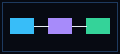
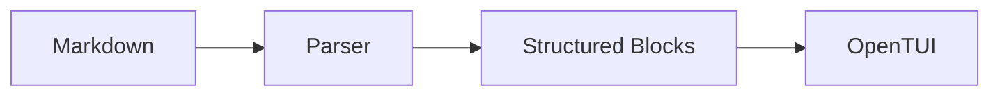

# Terminal Native Talks
---
layout: cover
subtitle: A full TalkTUI primitive tour
author: nexxel
date: 2026
---

One Markdown file. Multiple layouts. Zero browser chrome.

<!-- stop -->

:::tip Why this matters
The terminal is already where developer attention lives.
:::

# The Promise
---
layout: statement
subtitle: Ship the talk like you ship the tool
---

Text stays editable. Presentation stays fast.

::space:2::

No export step. No heavyweight canvas. No ceremony.

# Presentation Primitives
---
layout: two-cols
subtitle: Small pieces, composed per slide
---

- layout frontmatter
- progressive fragments
- styled callouts
- first-class code blocks
- terminal tables

::right::

:::note Authoring rule
Every primitive starts as readable Markdown and becomes structured data before render.
:::

---

{width=56 height=14 fit=contain caption="structured markdown pipeline"}

# Code Is A Surface
---
layout: code
subtitle: Metadata belongs on the fence
---

```ts [src/parser.ts] {2,5-8} lines title="Parser pipeline"
const source = yield* readFile(args.file)
const deck = yield* parseSlides(source)

root.render(
  <DeckApp deck={deck} config={config} />
)
```

:::warning Execution comes later
For now code is display-first. Running snippets is a separate, safer primitive.
:::

# Diagrams From The Start
---
layout: center
subtitle: Mermaid flowcharts become terminal diagrams
---



# Progressive Reveals
---
layout: center
subtitle: Same section, multiple fragments
---

Start with the point.

<!-- stop -->

Then reveal the supporting structure.

<!-- stop -->

- parser keeps fragment metadata
- footer shows step count
- rendering stays deterministic

# Slide Metadata
---
layout: section
title: Metadata Controls Chrome
subtitle: title, subtitle, author, date, variant, hideHeader, hideFooter
---

Metadata lets a slide describe itself without leaking layout rules into body content.

# A Big Fact
---
layout: fact
title: Latency Budget
---

17ms

# Callout Vocabulary
---
layout: default
subtitle: Docs-style semantics, terminal styling
---

:::note Note
Useful context that should not dominate the slide.
:::

:::tip Tip
Advice the audience can act on immediately.
:::

:::warning Warning
Something can go wrong if ignored.
:::

:::danger Danger
This is the sharp edge.
:::

# Tables Without Regret
---
layout: center
subtitle: Pipe tables become aligned terminal blocks
---

| Primitive | Status | Why |
| --- | --- | --- |
| Layouts | Done | Per-slide composition |
| Code | Done | Highlighted developer content |
| Tables | Done | Readable terminal data |
| Execution | Later | Needs safety boundaries |

# Fullscreen Mode
---
layout: cover
hideHeader: true
hideFooter: true
---

Sometimes the slide should own the whole terminal.

::space:2::

No chrome. Just the message.

# End
---
layout: quote
subtitle: Final slide
---

> Build the presentation system as carefully as the presentation.
